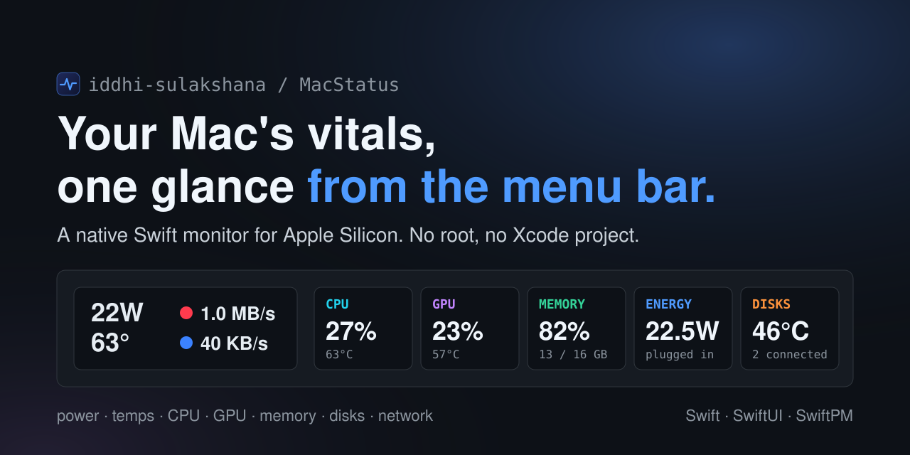
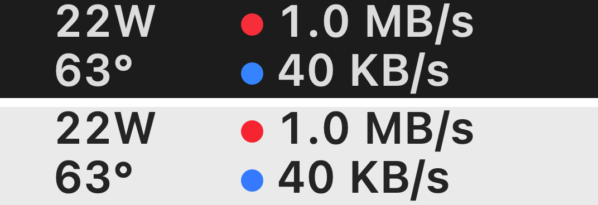
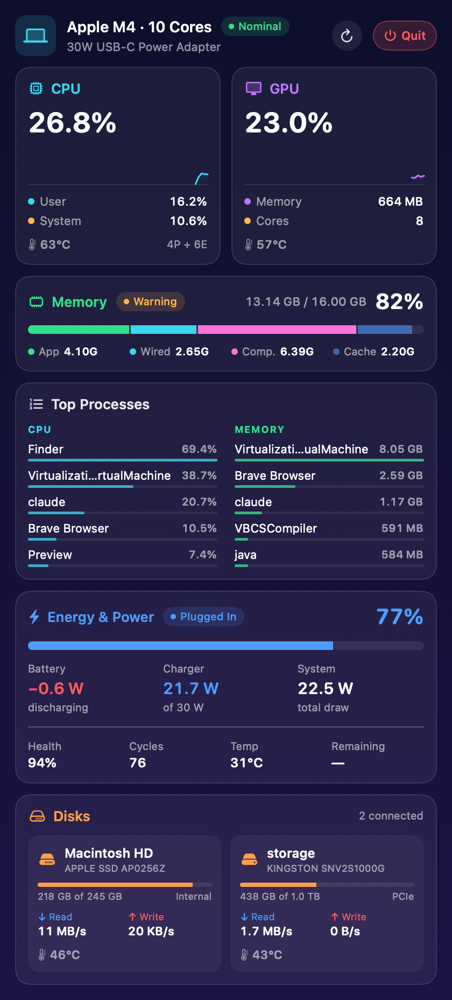
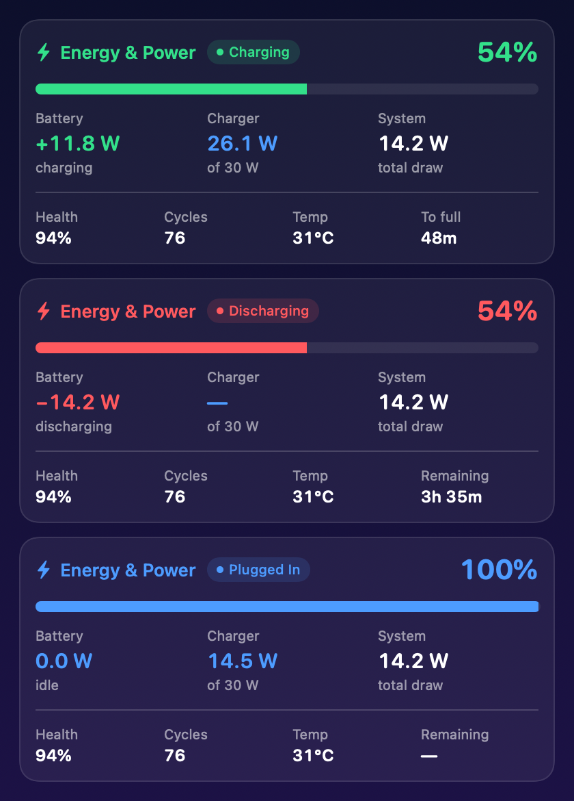

<p align="center">
  
</p>

# MacStatus

A system monitor that lives in the macOS menu bar. Native Swift and SwiftUI, built with SwiftPM, no root helper and no Xcode project.

The menu bar item shows the **live system power draw** and **CPU temperature** stacked on the left, with the **upload** (red) and **download** (blue) speed on the right. Click it for the full popup.

<p>
  
</p>

## The popup

<p>
  
  
</p>

| Card | What it shows |
| --- | --- |
| **Header** | Chip name and core count, the connected charger, the system's thermal state, **Refresh** and **Quit** |
| **CPU** and **GPU** | Utilisation with a short history, user / system split, performance and efficiency cores, GPU memory and core count, temperatures |
| **Memory** | Used and total, memory pressure, and a bar split into app, wired, compressed and cached |
| **Top processes** | The five busiest by CPU and by memory, side by side. Rows are grouped by app bundle |
| **Energy and power** | Battery level and power, charger input and rating, total system draw, battery health, cycle count, temperature, time remaining or time to full |
| **Disks** | One card per connected disk: name, model, capacity used, read and write speed, temperature |

The energy card's colour tells you what the battery is doing at a glance:

| State | Colour |
| --- | --- |
| Charging | green |
| Discharging | red |
| Plugged in, not charging | blue |

The right-click menu has **Refresh Now**, **Launch at Login** and **Quit MacStatus**.

## Requirements

- A Mac with Apple Silicon, running macOS 14 or newer.
- A Swift 5.9+ toolchain (Xcode or the Command Line Tools).

It was built and tested on an M4 MacBook on macOS 26. The sensors are read by key, so a different chip may be missing some of them. A value that can't be read is left out instead of shown as zero.

## Build and run

```sh
Scripts/build-app.sh          # release build -> build/MacStatus.app (ad-hoc signed)
open build/MacStatus.app
```

`Scripts/build-app.sh debug` makes a debug build instead. The app is menu-bar-only (`LSUIElement`), so there is no Dock icon: look for it at the right of the menu bar.

Everything is sampled once a second. The one exception is the process list, which is the expensive part and is only gathered while the popup is open.

## Where the numbers come from

Everything is read without root.

| Value | Source |
| --- | --- |
| System power (the menu bar watts) | SMC key `PSTR`. Charger input comes from `PDTR` |
| CPU temperature | Average of the SMC `Tp*` and `Te*` sensors (performance and efficiency cores), found by prefix. Falls back to the HID `PMU tdie` sensors |
| GPU temperature | Average of the SMC `Tg*` sensors |
| Internal SSD temperature | The HID sensor named `NAND` |
| External NVMe temperature | The drive's `NVMeSMARTLib` plug-in, cached for 10 s |
| Battery health, cycles, temperature | `AppleSmartBattery` |
| Processes | `libproc` |

**Why `PSTR` and not the battery's own telemetry.** `PowerTelemetryData` inside `AppleSmartBattery` stays stale for many seconds, so it is only used as a fallback when the SMC read fails.

**Known limits.**

- `libproc` can only read about 300 of the roughly 470 processes without root. Root daemons such as `WindowServer` and `kernel_task` are missing from the top-processes list.
- There are no per-block SoC power numbers (CPU, GPU, ANE watts). That needs IOReport and isn't built yet.

## Not built yet

- Customising the menu bar item (styles and per-item toggles).
- An app icon.
- Per-block SoC watts.
- **Launch at Login** and the right-click menu are written but haven't been tested yet.

## Regenerating the screenshots

The images above are rendered by the app itself from live readings, so no screen capture is involved:

```sh
build/MacStatus.app/Contents/MacOS/MacStatus --preview /tmp/macstatus   # popup.png, menubar.png, energy-states.png
build/MacStatus.app/Contents/MacOS/MacStatus --show-popup         # launch with the popup already open
```

`--preview` writes the three PNGs and exits. It also shows the energy card in all three states, using sample values, which is how `energy-states.png` is made.

## Layout

```
Sources/MacStatus/
  AppDelegate.swift, main.swift     launch, --preview and --show-popup
  StatusItemController.swift        the menu bar item, popover and right-click menu
  MenuBarRenderer.swift             draws the stacked readout and the network dots
  PreviewRenderer.swift             renders the popup and menu bar item to PNGs
  Model/                            StatsStore (1 s sampling loop), snapshot types
  Monitors/                         CPU, GPU, memory, network, power, disks, processes, SMC, HID, NVMe SMART
  Views/                            the popup's SwiftUI cards
  Support/                          formatting and low-level system helpers
Scripts/build-app.sh                builds and signs build/MacStatus.app
```
